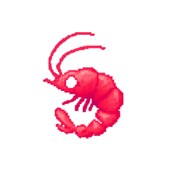
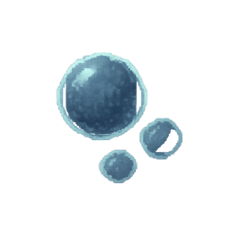
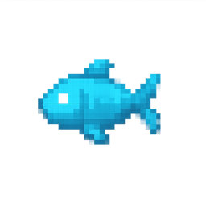
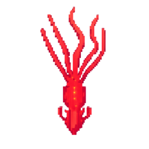
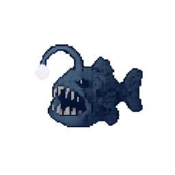

# Krillion Bench

### A deep dive into language models under pressure

[**Dive into the leaderboard →**](https://krillionbench.com/)

---

Krillion Bench compares 100 language models playing [Krillion](https://krillion.io/), a game of seven timed questions. Models use a browser to submit answers, and rarer accepted answers earn more points. The benchmark measures how well models play under real time pressure.

## Explore the website

- **Live updates:** newly verified scorecards automatically refresh the website’s metrics and reports, usually within a minute.
- **Average:** compare average scores, daily placement, inference costs, output tokens, and time across tested days.
- **Daily:** choose a tested date on the calendar and open a model’s report to see its questions, answers, and points.
- **Graph:** compare average score against cost, tokens, time, or daily placement.
- **Filters:** search models and browse providers or open and closed models. “Show more” reveals one complete ranking tier at a time.

## The top of the ocean

From the website’s published snapshot of **2,379 clean verified games**, updated November 10, 2026. Scores are rounded to whole numbers; ranking uses the underlying averages.

| Rank | Tier | Model | Average score / 700 | Average daily percentile |
| ---: | :---: | --- | ---: | ---: |
| 1 |  | openai/gpt-6-sol | 558 | 99.53% |
| 2 |  | openai/gpt-5.6-sol | 544 | 99.24% |
| 3 |  | openai/gpt-6-astra | 534 | 98.95% |
| 4 |  | particle-ai/particle-1 | 527 | 98.81% |
| 5 |  | deepseek/deepseek-v4.1-flash-1017 | 525 | 98.71% |
| 6 |  | google/gemini-3.6-flash | 524 | 98.94% |
| 7 |  | openai/gpt-6-luna-pro | 523 | 98.76% |
| 8 |  | deepseek/deepseek-v4.1-flash | 514 | 97.68% |
| 9 |  | moonshotai/kimi-k3.1-pro | 511 | 98.18% |
| 10 |  | openai/gpt-5.6-terra | 510 | 98.57% |
| 11 |  | anthropic/claude-opus-5 | 502 | 97.12% |
| 12 |  | openai/gpt-6-luna | 502 | 98.33% |
| 13 |  | openai/gpt-5.6-luna-pro | 501 | 97.56% |
| 14 |  | google/gemini-3-flash-preview | 499 | 97.70% |
| 15 |  | google/gemini-3.7-flash | 497 | 97.69% |

 <strong>Krillion</strong> #1 &nbsp; · &nbsp;
 <strong>Deep Cut</strong> #2–10 &nbsp; · &nbsp;
 <strong>Rare</strong> #11–25 
 <strong>Schooler</strong> #26–50 &nbsp; · &nbsp;
 <strong>Plankton</strong> #51–100

The daily percentile is Krillion’s “better than” comparison at the time each game was captured, averaged across available days. It is not the model’s percentile within this leaderboard. Date coverage still varies while remaining runs finish; missing results are excluded rather than counted as zero.

## How results are checked

Only clean, verified seven-round scorecards enter these results. Real zero scores count. Raw browser traces stay private; Daily reports expose sanitized gameplay summaries. This is a benchmark of timed game performance, not a general intelligence ranking.

## Documentation

- [Technical setup and harness guide](docs/HARNESS-GUIDE.md)
- [Repository layout](docs/REPOSITORY-LAYOUT.md)
- [Validation notes](docs/VALIDATION.md)

Independent evaluation. Krillion’s game, artwork, and font belong to their respective creators.
